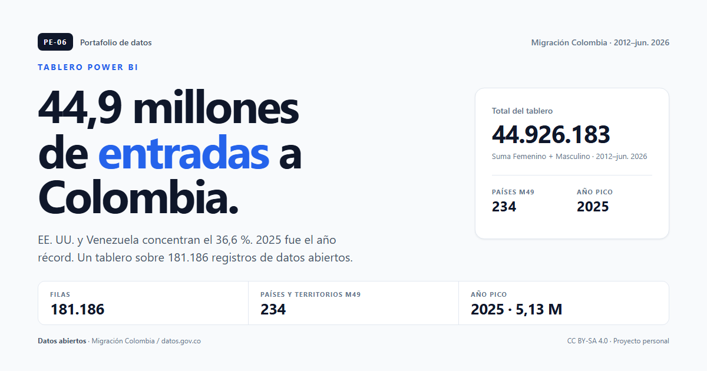

# Entradas de extranjeros a Colombia · PE-06

Página estática del tablero de Power BI sobre las entradas de extranjeros a Colombia, 2012 – junio de 2026. Construida con datos abiertos de Migración Colombia, Power Query, DAX y una tabla de fechas marcada.

- **Página:** https://edstdico.github.io/turismo-colombia-powerbi/
- **Tablero en Power BI:** https://app.powerbi.com/view?r=eyJrIjoiNmFiN2FkY2EtMGVhMi00NzE0LTliMWItYmM3MDBmMDU2OWFhIiwidCI6IjYzN2YzZGJlLWJmNWYtNDA2ZS1hNzA1LWNhODc0YjYwNjBhMiIsImMiOjR9
- **Repositorio:** https://github.com/EdStDiCo/turismo-colombia-powerbi



## Qué es

PE-06 es un **proyecto personal** de portafolio. No es experiencia laboral ni un producto oficial de Migración Colombia.

La página cuenta el hallazgo principal y muestra el tablero embebido bajo demanda. Alrededor del tablero documenta el proceso completo: fuentes, extracción y limpieza, modelado, cálculos, visualización y despliegue. También expone los problemas de calidad del dato y lo que el tablero **no** puede responder.

## Cifras base

| Dato | Valor |
|---|---|
| Fuente | Migración Colombia, *Entradas de extranjeros a Colombia* (`96sh-4v8d`, datos.gov.co) |
| Filas | 181.186 |
| Periodo | 2012 – junio 2026; **2026 solo enero–junio** |
| Total del tablero (Femenino + Masculino) | **44.926.183** |
| Suma `Total` de la fuente | 44.928.340 |
| Suma F+M de la fuente | 44.926.289 |
| Diferencia fuente vs tablero | 2.157 (2.051 explicados por 1.275 filas; 106 por reconciliar) |
| Países y territorios M49 | **234** |
| Códigos distintos | 239: 234 M49 + Kosovo (901) + 4 residuales (`9941`, `9981`, `9997`, `99999`) |
| Año pico | **2025**, con 5.130.449 entradas |
| 2024 | 4.844.287 entradas; **+5,9 %** en 2025 |
| 2026 | 2.430.484 entradas (ene–jun); **−2,7 %** vs ene–jun 2025 |
| Nacionalidades principales | EE. UU. 9.088.305; Venezuela 7.356.402; juntas **36,6 %** |

## El tablero

Incluye KPIs, evolución anual, mapa de puestos de control migratorio, ranking de nacionalidades y filtros por año y región. El iframe se carga solo cuando se hace clic en **Cargar tablero**; si el embed falla, el enlace **Abrir en Power BI** sigue disponible.

No se usa una captura del tablero como imagen de respaldo. El póster y la tarjeta `og.png` son piezas diseñadas.

## Proceso

1. **Fuentes.** API Socrata de datos.gov.co y estándar UN M49. Corte de la fuente: 20/08/2026; último mes con datos: junio 2026. Licencia CC BY-SA 4.0.
2. **Extracción y limpieza.** Cuatro páginas de 50.000 filas con `$order=:id`; tipado, renombrado de `Total` a `Viajeros`, unión con la dimensión M49 y revisión de nulos y códigos residuales en Power Query. `Indefinido` está 100 % vacía.
3. **Modelado dimensional.** Tabla de hechos `Entradas_de_extranjeros_a_Colombia_20261124`, dimensión `UNSD — Methodology` (M49), tabla de fechas marcada y relación con hechos. El nombre conserva el snapshot del modelo: `20261124`.
4. **Cálculos y lógica de negocio.** Medidas DAX para total, año pico y países emisores; el total usa `Viajeros` (Femenino + Masculino), no la columna `Total` original.
5. **Visualización y storytelling.** KPIs, evolución anual, mapa PCM, ranking y slicers. 2026 se marca como parcial y no se compara con años completos.
6. **Despliegue y gobernanza.** Power BI Service con publish-to-web; página estática en GitHub Pages. La fuente es semestral, así que la actualización es manual. Snapshot, licencia y límites visibles.

## Calidad del dato

- **Códigos residuales:** 4 códigos con 26.515 entradas. `99999` concentra 24.301; los tres códigos de “No Aplica” suman 2.214. Se reportan aparte.
- **Nombres duplicados:** 24 códigos M49 tienen dos variantes por mayúsculas (“de”/“De”, “y”/“Y”). Se unifican por código.
- **Total vs Femenino + Masculino:** 1.275 filas tienen `Total` ≠ F+M, con un neto de 2.051 entradas. El tablero usa F+M.
- **Columna `Indefinido`:** 100 % vacía; se excluye.
- **2026 parcial:** solo enero–junio; la comparación justa es contra ene–jun 2025.
- **Kosovo (901):** 298 entradas; no está en M49 y se reporta aparte del conteo de países.

La diferencia de 106 entradas entre la suma F+M de la fuente (44.926.289) y el visual (44.926.183) queda documentada como pendiente de reconciliación. No se oculta ni se “ajusta” la cifra.

## Lo que el tablero no responde

- No son personas únicas: cada fila es una entrada registrada.
- Nacionalidad no es residencia.
- 2026 está incompleto.
- La fuente es semestral; no hay tiempo real.
- No explica causas, motivo de viaje, edad, aeropuerto ni tipo de visa.

## Stack y desarrollo

- **HTML** estático y **JavaScript vanilla** mínimo para cargar el iframe bajo demanda.
- **Tailwind CSS 3.4.17** con el tema por defecto. El CSS se compila en local y se commitea; la página no usa el CDN de Tailwind en runtime.
- **Power BI** para el tablero, **Power Query** para la preparación y **DAX** para las medidas.

### Comandos

```bash
npm install        # solo para reconstruir el CSS
npm run build:css  # genera styles.css minificado
npm run watch:css  # modo desarrollo
```

`styles.css` es generado por Tailwind: no se edita a mano. Los archivos fuente del CSS están en `src/input.css` y `tailwind.config.js`.

### Estructura

```text
.
├── index.html
├── styles.css          # generado por Tailwind
├── script.js           # carga diferida del iframe
├── assets/
│   ├── favicon.svg
│   ├── og-card.html    # fuente de la tarjeta social
│   └── og.png          # 1200 × 630
├── src/
│   └── input.css
├── tailwind.config.js
├── package.json
└── README.md
```

## Publicación

El sitio está pensado para GitHub Pages desde la rama `main`, carpeta raíz, con rutas relativas. La URL canónica y las etiquetas Open Graph apuntan a `https://edstdico.github.io/turismo-colombia-powerbi/`.

Para publicar:

1. Subir el repositorio a `github.com/EdStDiCo/turismo-colombia-powerbi`.
2. En **Settings → Pages**, elegir `Deploy from a branch`, rama `main`, carpeta `/ (root)`.
3. Verificar la página en incógnito, en móvil y con el iframe bloqueado.
4. Reemplazar el placeholder de LinkedIn (`TU-USUARIO`) por el perfil real.

## Licencia y atribución

**Datos:** Migración Colombia, *Entradas de extranjeros a Colombia*, datos.gov.co, corte 20/08/2026. Licencia [CC BY-SA 4.0](https://creativecommons.org/licenses/by-sa/4.0/).

**Estándar:** United Nations M49, *Standard country or area codes for statistical use*.

La página y el tablero son obras derivadas de esos datos y se comparten bajo **CC BY-SA 4.0**: se debe dar atribución y compartir las adaptaciones bajo la misma licencia. No hay afiliación con Migración Colombia.

Ver [`LICENSE`](LICENSE) para el aviso de licencia.

## Pendientes conocidos

- Reconciliar las 106 entradas restantes entre la suma F+M de la fuente y el visual.
- Confirmar el comportamiento del embed en incógnito y en un móvil real.
- Sustituir el placeholder de LinkedIn.
- Activar GitHub Pages si aún no está activo.
